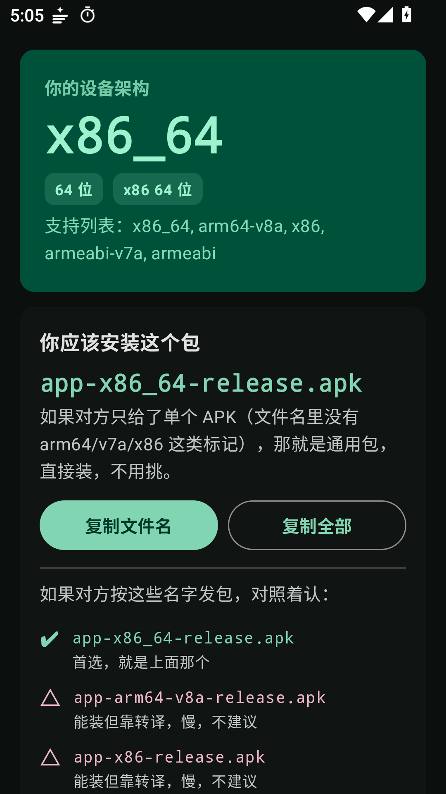
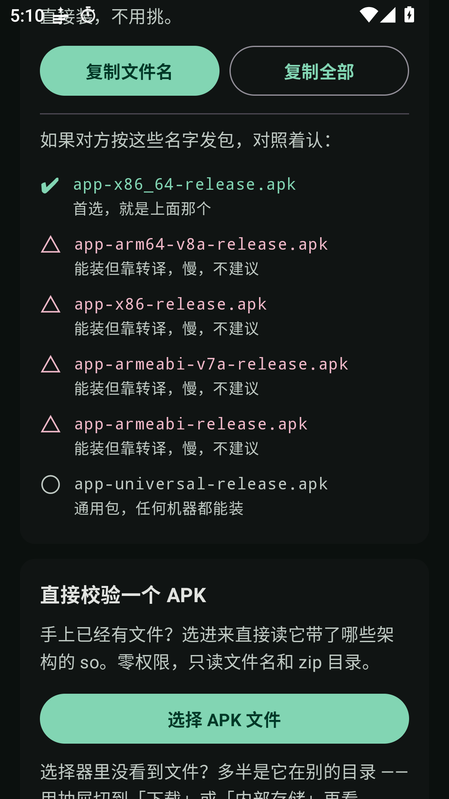

# 架构通（AbiLens）

> 让用户装 App 之前就知道：**我是什么架构，该下载哪个分片包。**

<p>
  
  
</p>

## 下载

从 [Releases](releases/latest) 下载 **`AbiLens-v1.0.0.apk`**（0.91 MB），
传到手机上安装即可。

- 支持 Android 5.0（API 21）及以上
- 只有一个包，不分架构 —— 任何手机都装得下
- 不联网、不申请任何权限

## 它解决什么

分架构打包（`armeabi-v7a` / `arm64-v8a` / `x86` / `x86_64`）能把包体压到 1/3 左右，
代价是**用户可能拿错包**。典型翻车现场：

- 64 位手机装了 `armeabi-v7a` 包 —— 带 native 库时启动即崩（`UnsatisfiedLinkError`）；
- 模拟器装了 `arm64-v8a` 包 —— 直接装不上（`INSTALL_FAILED_NO_MATCHING_ABIS`）；
- 更隐蔽的一种：包里**根本没有 so**，装错架构照样能跑，只是白占了几倍空间，
  用户永远不会知道自己拿错了。

这个 App 就是发给对方、让他自己判断的那一步。

## 四个功能

| 功能 | 做什么 |
|---|---|
| **架构速查** | 大字显示本机 ABI + 该下载的文件名，一键复制 |
| **APK 校验器** | 选一个 APK 进来，直接读它 zip 里的 `lib/*`，给出「装得上 / 装不上」+ 原因 |
| **文件名校验** | 不选文件，粘贴文件名也能判断 |
| **分发文案** | 生成一段可直接发给对方的话，带复制和分享 |

## 关键设计

### 零权限

`AndroidManifest.xml` 里**没有任何 permission**。校验 APK 走 SAF
（`ACTION_OPEN_DOCUMENT`）—— 用户选哪个文件，系统就把哪个临时授权给我们。
这既是"能安心装到别人手机上"的前提，也避免了在 Android 13+ 上申请存储权限的麻烦。

### 判定逻辑不碰 Android API

`core/Abi.kt` 里没有一行 `import android.*`，整套 ABI 判定是纯 Kotlin。
所以它能被 JVM 单元测试直接跑 —— **装机实测只能验证 UI，验证不了边界**，
而这个 App 的全部价值就在边界判断准不准。24 个用例覆盖：

- `x86_64` 不能被误判成 `x86`（长名优先 + 区间去重）
- `armeabi-v7a` 不能被截成 `armeabi`（同样是长名优先）
- `armeabi` 必须被识别为架构 —— 漏了它会让 `app-armeabi-release.apk`
  被误判成「通用包，装哪都行」，实测踩过
- 边界检查：`myarm64-v8a-notes.apk` 不能误命中
- **64 位设备不一定能跑 32 位包** —— 一律以 `Build.SUPPORTED_ABIS` 自报列表为准
- 无 `lib` 目录的包 → 架构无关，绝不误报

### 分四档，而不是「能装 / 不能装」

`✔ 首选` / `△ 能装但靠转译，慢，不建议` / `○ 通用包，任何机器都能装` / `✗ 装不上`

为什么必须分档：x86 模拟器上装 arm64 包**装得上，但跑起来是转译**，慢且部分 App
不兼容。只标「✔ 能装」会让用户以为三个包随便挑。**「能装」和「该装」是两回事。**

### 只出 universal，不做 ABI 分片

这个 App 不含任何 native 库（`packaging.jniLibs.excludes` 把 so 全排了），
所以四个 ABI 分片是**逐字节相同的文件** —— 分片等于凭空复制 4 份去分发。

它教别人「别装错架构包」，自己就不做那件事。

## 体积与性能

| 项 | 实测 |
|---|---|
| Release APK | **0.91 MB**（950,717 字节） |
| Debug APK | 约 8.7 MB |
| 冷启动 | 约 0.16 秒 |
| 单元测试 | 24 通过 / 0 失败 |

其中约 94% 是 Compose + Material3 自身的 dex，不是本项目代码。
R8 删掉了 3.9 万个未使用项。

额外剔除了：

- `lib/*.so`（依赖带的 `libandroidx.graphics.path.so`，四架构共约 38 KB）
- 自动生成的 baseline profile

## 构建

```bash
./gradlew testDebugUnitTest assembleRelease --offline
```

产物：`app/build/outputs/apk/release/app-release.apk`

### 签名

正式版使用专用签名证书。构建时从 `app/keystore.properties` 读取密钥配置
（该文件与 `.jks` 都在 `.gitignore` 中，不入库）。

**没有该文件时会自动降级到 debug 签名**，方便他人 clone 源码后直接构建，
只是打出来的包无法覆盖安装官方版本。

当前发布证书 SHA-256：

```
4F:C7:97:2B:0F:CF:8F:23:C7:99:30:4B:47:3D:04:A6
89:D2:3C:B7:92:CD:2E:2B:F0:7C:D7:DE:EF:14:6D:24
```

核对下载的包有没有被篡改：

```bash
apksigner verify --print-certs AbiLens-v1.0.0.apk
```

## 实测记录

| 项 | 结果 |
|---|---|
| 冷启动 | 约 0.16 秒（三次实测 197 / 154 / 159 ms） |
| 架构显示 | 与 `getprop ro.product.cpu.abilist` 首项一致 |
| 不匹配判定 | 输 `armeabi-v7a` → 红色「不匹配」+ 建议应下载的文件名 ✅ |
| 复制反馈 | Snackbar「已复制：文件名」出现 ✅ |
| 签名 | v1 / v2 / v3 全部通过 ✅ |
| 单元测试 | 24 通过 / 0 失败（含负验证） |

## 踩过的坑

**1. 清单里的 Activity 名写成 `.MainActivity` 但类在 `ui` 子包下**

编译期不报错（AGP 不校验类是否存在），运行时才抛
`ClassNotFoundException: com.abilens.app.MainActivity`，一片崩溃。
现在清单写全限定名，且目录结构与包名严格一致。

**2. `PackageInfo.targetSdkVersion` / `minSdk` 在 compileSdk 36 下 unresolved**

查证过：`android-36/android.jar` 的 `PackageInfo.class` 里**确实没有这两个字段**。
不是写法问题，是 SDK 裁剪掉了。这两个字段对本工具无用，已移除。

**3. 只传 APK 的 MIME，选择器里一个 `.apk` 都不显示**

DownloadsProvider 对没索引 MIME 的文件统一报 `octet-stream`。
改成同时传标准 MIME 和 `*/*`，并在界面上加了兜底说明。

**4. 中文引号写在 KDoc 里会把注释提前闭合**

`/** ...选择器在"最近"页里... */` 里的引号导致 `Syntax error: Expecting an element`，
报错行号还指向别处。KDoc 内统一用中文书名号「」。

**5. `Build.SUPPORTED_ABIS` 里会出现 `armeabi`，但判定表里漏了它**

后果不是"少识别一种"，而是把 `app-armeabi-release.apk` 当成
「文件名里没有架构标记」→ 误判为**通用包**，等于告诉用户"装哪都行"。
现已补全，并加了回归测试。

## 目录

```
app/src/main/java/com/abilens/app/
├── core/
│   ├── Abi.kt           纯 Kotlin：ABI 知识 + 判定逻辑（可 JVM 测试）
│   ├── DeviceProbe.kt   读设备信息 + 解析 APK 的 zip 目录
│   └── ApkInspector.kt  SAF URI → 缓存 → 解析
└── ui/
    ├── Theme.kt         主题
    ├── AbiLensApp.kt    主界面
    └── Components.kt    输入框、快捷 chip
```

## 许可

本项目为个人作品，源码未公开。APK 可自由分发与安装。